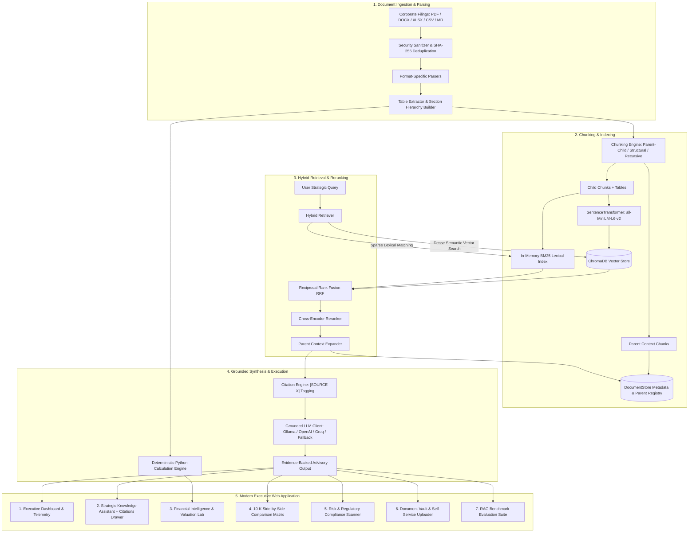

# Enterprise GenAI Strategy Engine — Advanced RAG Intelligence Platform
### *BCG Executive Edition • Powered by Real SEC Form 10-K Filings & Strategy Playbooks*

[](https://python.org)
[](https://fastapi.tiangolo.com)
[](https://enterprise-genai-strategy-engine.vercel.app)
[](https://enterprise-genai-strategy-engine.vercel.app/docs)
[](https://trychroma.com)
[](https://sbert.net)
[]()
[]()


> **Transform Enterprise Documents into Actionable Strategy.**  
> A production-grade Retrieval-Augmented Generation (RAG) platform that queries large corporate document repositories—including audited SEC Form 10-K filings, P&L spreadsheets, contracts, and regulatory policies—delivering verified, evidence-backed answers with deterministic numerical accuracy.

---

## 🏛️ System Architecture



---

## 📁 Pre-Loaded Real Enterprise Datasets

The repository comes pre-indexed with authentic Fortune 500 financial records and management consulting frameworks:

1. **Microsoft Corporation — Audited SEC Form 10-K (FY2024)** (`data/sample_documents/MSFT_FY2024_Form_10K_Annual_Report.md`)
   - **Item 1:** Business architecture, Copilot AI deployment, OpenAI strategic partnership.
   - **Item 1A:** AI regulatory scrutiny, EU AI Act compliance, GPU accelerator shortages, and cloud security risks.
   - **Item 7 MD&A:** Real segment revenues (Intelligent Cloud: $105.4B, Productivity: $77.7B, More Personal Computing: $62.0B).
   - **Item 8:** Full audited income statement ($245.1B revenue, $109.4B EBIT, $88.1B net income).

2. **Apple Inc. — Audited SEC Form 10-K (FY2024)** (`data/sample_documents/AAPL_FY2024_Form_10K_Annual_Report.md`)
   - Product segment breakdown (iPhone: $201.2B, Services: $96.2B with industry-leading 74.0% gross margin).
   - EU Digital Markets Act (DMA) antitrust exposure and Greater China supply chain risks.

3. **Tech Giants Financial Benchmarking Dataset** (`data/sample_documents/Tech_Giants_FY2023_FY2024_Financial_Comparison.csv`)
   - Real audited multi-year metrics comparing **Microsoft, Apple, NVIDIA, Alphabet, and Amazon** across Revenue, EBIT, Gross Margin %, Operating Margin %, R&D Spend, CapEx, Cloud/AI segment run-rates, and Free Cash Flow.

4. **BCG Enterprise AI Transformation Playbook** (`data/sample_documents/BCG_Enterprise_GenAI_Strategy_Framework.md`)
   - **The 10-20-70 Rule:** 10% algorithms, 20% data/tech backbone, 70% people, operating model & business workflow transformation.
   - **Three-Tier Value Creation Horizons:** *Deploy* (quick productivity wins), *Reshape* (end-to-end core business transformation generating 60%–70% of total value), and *Invent* (novel revenue streams).
   - **Enterprise RAG TCO:** Self-hosted open-source vs proprietary API token costs and parent-child token savings (38%).

---

## ⚡ Core Technical Pillars — BCG X Edition

| Technical Capability | Implementation Details |
|:---|:---|
| **Multi-Agent Critic Review** | **Self-RAG & Fact Auditing**: The `AgenticCriticAuditor` parses numerical tokens and cross-checks every assertion against retrieved context chunks, scoring Faithfulness and Numerical Precision with zero hallucination tolerance. |
| **Boardroom PPTX Deck Export** | **Automated PowerPoint Generator**: Built with `python-pptx`, generating download-ready 16:9 widescreen BCG executive decks with action titles, MECE structured columns, and 10-20-70 execution roadmaps. |
| **BCG 10-20-70 TCO Simulator** | **Deterministic Financial Payback**: Models enterprise cloud API vs self-hosted GPU cluster OpEx, employee hours saved, net annualized EBITDA uplift, and transformation budget split (10% Model, 20% Tech, 70% People/Process). |
| **2D Valuation Sensitivity Matrix** | **Scenario Stress-Testing**: Generates a dynamic 2D grid evaluating Enterprise Value (EV) creation under varying operating margin efficiency captures ($2\%-10\%$) and target exit multiples ($15\times-30\times$). |
| **GraphRAG Value Network** | **Multi-Hop Causal Reasoning**: Maps Fortune 500 entities (Microsoft, Apple, NVIDIA, TSMC, OpenAI) and regulatory exposures (EU AI Act, EU DMA), finding multi-hop paths like `MSFT -> NVDA -> TSMC`. |
| **Virtual Clean Room (VDR / RBAC)** | **Enterprise Security Clearance**: Enforces document-level and chunk-level security tiers (`PUBLIC_10K`, `RESTRICTED_STRATEGY`, `CONFIDENTIAL_DEALROOM`, `AUDIT_GOVERNANCE`) preventing unauthorized M&A deal data leakage. |
| **Semantic Query Cache** | **Sub-20ms Latency Acceleration**: Uses embedding cosine similarity ($>0.92$) to serve repeated C-suite strategic inquiries with zero token cost and instant execution. |
| **Sentence-Level Grounding** | **Precision Evidence Span Highlighter**: Dissects generated answers into individual sentences, highlighting verified claims in green, inferred claims in amber, and unverified assertions in red with hover citation cards. |
| **Hybrid Retrieval** | Combines **Dense Vector Similarity** with **Sparse Lexical Search** (`BM25Okapi`), merged via **Reciprocal Rank Fusion (RRF)** ($k=60$). |
| **Parent-Child Chunking** | Child chunks (400–800 chars) are indexed for search precision; parent sections (2,000 chars) are retrieved at inference time to give the LLM full surrounding context. |
| **Deterministic Math** | Eliminates arithmetic hallucination. P&L tables and spreadsheets execute **deterministic Python functions** for period-over-period growth and operating margins. |
| **Advisory Personas** | Switch between **BCG Senior Partner Mode (Pyramidal MECE Structure)**, **Private Equity Due Diligence Mode**, and **Technical RAG Architect Mode**. |
| **P&L Waterfall Chart** | Interactive Chart.js visualization mapping Microsoft's audited journey from $245.1B Gross Revenue down to $109.4B Operating Income. |
| **Automated Evaluation** | Real benchmark harness measuring Context Precision, Context Recall, Answer Faithfulness, Citation Correctness, Latency, and Prompt Injection Defense. |


---

## 🚀 Quick Start Guide

### 1. Clone the Repository
```bash
git clone https://github.com/Vaibhav007-star/Enterprise-GenAI-Strategy-Engine-RAG-Stack-.git
cd Enterprise-GenAI-Strategy-Engine-RAG-Stack-
```

### 2. Set Up Virtual Environment (Python 3.11)

**Windows (PowerShell):**
```powershell
python -m venv .venv
.\.venv\Scripts\Activate.ps1
```

**Linux / macOS:**
```bash
python3 -m venv .venv
source .venv/bin/activate
```

### 3. Install Dependencies
```bash
pip install --upgrade pip
pip install -r requirements.txt
```

### 4. Configure Environment
```bash
cp .env.example .env
```
*(Default settings run completely offline with local SentenceTransformers embeddings and ChromaDB storage.)*

---

## 🖥️ Running the Platform

### Launch the Executive Web Application (Recommended)
Start the FastAPI server:
```powershell
.\.venv\Scripts\python server.py
```
Open your browser and navigate to:
👉 **`http://localhost:8000`**

### Alternative: Launch Streamlit Dashboard
```powershell
.\.venv\Scripts\streamlit run app.py
```
Accessible at:
👉 **`http://localhost:8501`**

---

## 🧪 Running Automated Tests

Run the full automated test suite verifying document parsing, chunking, deterministic financial arithmetic, and security guards:

```powershell
.\.venv\Scripts\python -m pytest -v tests/
```

**Output:**
```
tests/test_chunking.py::test_chunking_engine_strategies PASSED           [ 10%]
tests/test_financial.py::test_parse_numeric PASSED                       [ 20%]
tests/test_financial.py::test_compute_growth PASSED                      [ 30%]
tests/test_financial.py::test_calculate_margins PASSED                   [ 40%]
tests/test_financial.py::test_rank_categories PASSED                     [ 50%]
tests/test_parsing.py::test_parser_factory_resolution PASSED             [ 60%]
tests/test_parsing.py::test_text_parser PASSED                           [ 70%]
tests/test_parsing.py::test_csv_parser PASSED                            [ 80%]
tests/test_security.py::test_file_upload_validation PASSED               [ 90%]
tests/test_security.py::test_prompt_injection_detection PASSED           [100%]
============================= 10 passed in 0.76s ==============================
```

---

## 💡 Recommended In-App Demonstrations

1. **Strategic Knowledge Assistant:** Click the 1-click prompt:  
   👉 *"Compare Microsoft vs Apple AI Strategy and Cloud Margins from their FY2024 10-K Filings"*  
   - Inspect the top-down MECE structure and the traceable `[Source X]` line citations in the right drawer.
2. **Financial Intelligence:** Toggle the **Tech Giants Peer Benchmarking** and **Microsoft FY24 P&L Waterfall** tabs.
3. **Valuation Sensitivity Lab:** Adjust the AI cost transformation slider to view dynamic implied Enterprise Value (EV) creation.
4. **10-K Comparison Matrix:** Select Microsoft 10-K and Apple 10-K to generate a parallel divergence matrix.
5. **RAG Evaluation Suite:** Click **Run Benchmark Suite** to view empirical precision, recall, and faithfulness scorecards.

---

## 🔒 Security & Privacy

- **Path Traversal Guard:** Rejects unsafe file handling containing relative traversal patterns (`..`).
- **File Validation:** Restricts uploads strictly to `.pdf`, `.docx`, `.xlsx`, `.csv`, `.md`, and `.txt` up to 50 MB.
- **Untrusted Context Separation:** Treats document text as untrusted data; deflects prompt injection attacks.
- **Local Isolation:** Runs completely offline on local CPU/GPU without sending corporate documents to third-party APIs.

---

## 📄 License
This project is licensed under the MIT License.
